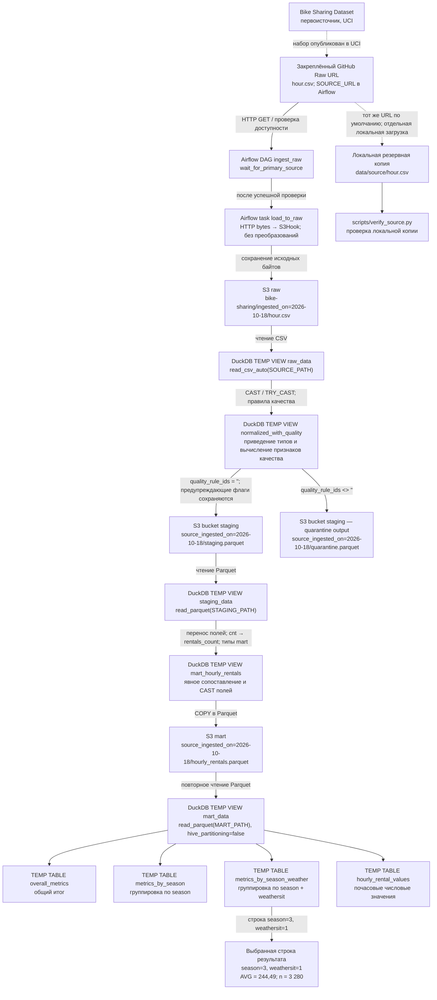

# Документирование аналитического контура — ЛР № 6

**Выполнили:** Попов Никита и Гордий Владимир  
**Группа:** ИВТ-241  
**Проект:** Bike Sharing Dataset — анализ спроса на прокат велосипедов

## 1. Контекст анализа

### 1.1. Исследовательский вопрос

**Вопрос из Project Brief:** как различается количество аренд велосипедов в зависимости от сезона и погодных условий?

Анализ является описательным: результаты показывают наблюдаемые различия между группами, но не доказывают, что сезон или погодные условия являются причиной изменения спроса.

### 1.2. Выбранное значение метрики

Для прослеживания происхождения данных выбрана метрика **среднего количества аренд за одно часовое наблюдение** для группы:

- `season = 3`;
- `weathersit = 1`.

| Показатель | Значение |
|---|---:|
| Метрика | `avg_rentals_per_hour` |
| Значение после округления | **244,49 аренды за час** |
| Сумма аренд в группе | 801 941 |
| Количество часовых наблюдений | 3 280 |
| Количество непустых значений `rentals_count` | 3 280 |
| Период исходных наблюдений, доступный в витрине | 2011-01-01 — 2012-12-31 |
| Срез | `season = 3`, `weathersit = 1` |

Расчёт выполняется по формуле:

\[
\operatorname{AVG}(rentals\_count) = \frac{\operatorname{SUM}(rentals\_count)}{\operatorname{COUNT}(rentals\_count)}
= \frac{801\,941}{3\,280} = 244{,}494207\ldots \approx 244{,}49.
\]

В знаменатель вошли 3 280 непустых значений меры. В проверенной витрине `rentals_count` не содержит `NULL`, поэтому все 3 280 строк выбранной группы участвуют в расчёте. Значение `0`, если бы оно встретилось, оставалось бы допустимым числовым наблюдением; отрицательных значений в фактической витрине нет.

**Где найти результат:** `notebooks/calculate_metrics.ipynb`, ячейка 16 (Jupyter `In [8]`), отображаемый DataFrame `metrics_by_season_weather_result`. Выбрана строка с `season = 3` и `weathersit = 1`, столбец `avg_rentals_per_hour`. Данные группировки рассчитаны и сохранены во временной таблице DuckDB `metrics_by_season_weather`, а `metrics_by_season_weather_result` — результатный DataFrame, выведенный этой ячейкой.

### 1.3. Исходные данные и первоисточник

В Project Brief исходный набор указан как **Bike Sharing Dataset**, издатель — UCI Machine Learning Repository, автор набора — Hadi Fanaee-T. Для проекта используется почасовой файл `hour.csv`; одна исходная строка представляет одно часовое наблюдение. Набор описывает работу Capital Bikeshare за 2011–2012 годы.

Фактическая загрузка в проекте реализована DAG `ingest_raw` из `airflow/dags/ingest_raw.py`. В коде по умолчанию указан закреплённый GitHub Raw URL:

```text
https://raw.githubusercontent.com/alfozan/mlflow-example/fa1ed37c09962d5b134d07703ba95f07648b73e0/data/hour.csv
```

В `scripts/download_source.py` зафиксировано пояснение: исходный UCI endpoint возвращал HTTP 404 во время выполнения работы, поэтому для загрузки предусмотрен GitHub Raw fallback, закреплённый на конкретном commit SHA. В DAG URL задаётся переменной `SOURCE_URL`; значение по умолчанию приведено выше и может быть переопределено конфигурацией окружения. UCI указан как происхождение набора в Project Brief, а GitHub Raw URL — как фактический HTTP endpoint по умолчанию в коде загрузки.

Проверенный объект в S3 `raw`:

```text
s3://raw/bike-sharing/ingested_on=2026-10-18/hour.csv
```

Точный путь подтверждён в `docs/data_quality_report.md` и в параметрах ноутбука ЛР № 3. Дата `2026-10-18` — дата загрузки объекта в S3, а не дата наблюдения. Период самих наблюдений определяется по полю `dteday` и составляет 2011-01-01 — 2012-12-31.

## 2. Схема происхождения данных (Data Lineage)

### 2.1. Общая схема



Локальная копия `data/source/hour.csv` и проверка `scripts/verify_source.py` показаны пунктирной веткой как вспомогательный контур. Основной аналитический маршрут к `staging` начинается с объекта S3 `raw`: ноутбук ЛР № 3 читает `SOURCE_PATH` непосредственно из S3, а не из локальной копии.

### 2.2. Источник и загрузка в raw

Файл `airflow/dags/ingest_raw.py` содержит DAG `ingest_raw` с двумя связанными задачами:

1. `wait_for_primary_source` — `HttpSensor` проверяет доступность HTTP-источника и ожидает статус 200.
2. `load_to_raw` — `HttpHook` получает байты файла, а `S3Hook` сохраняет их в бакет `raw`.

Ключ объекта формируется по шаблону `{dataset_slug}/ingested_on={ingested_on}/{filename}`. Для зафиксированной загрузки это `bike-sharing/ingested_on=2026-10-18/hour.csv`. Задача проверяет существование бакета и объекта; если объект уже есть, повторная загрузка пропускается. Файл в `raw` сохраняется без очистки, разбора CSV или изменения байтов.

В проекте также присутствуют вспомогательные скрипты:

- `scripts/download_source.py` скачивает CSV в локальный резервный файл `data/source/hour.csv`;
- `scripts/verify_source.py` проверяет наличие обязательных столбцов локального файла и наличие первой строки;
- `scripts/read_raw.py` позволяет диагностически прочитать объект `s3://raw/...` через DuckDB и вывести названия столбцов и первые пять строк.

Эти скрипты не заменяют основной DAG и не являются шагом подготовки `staging`.

### 2.3. Подготовка staging и quarantine

В `notebooks/profile_quality.ipynb` сначала настраивается DuckDB `httpfs` для доступа к S3, затем создаётся временное представление `raw_data` чтением CSV по `SOURCE_PATH`. В профиле зафиксировано 17 379 строк и период 2011-01-01 — 2012-12-31. Физический CSV содержит 17 исходных полей; при чтении S3-пути с сегментом `ingested_on=2026-10-18` DuckDB также показывает партиционный столбец `ingested_on`, поэтому в отчёте профиля отображаются 18 столбцов. Для исходных значимых полей `dteday`, `hr`, `season`, `weathersit` и `cnt` пропусков не обнаружено; дубликатов по бизнес-ключу `dteday + hr` также нет.

Временное представление `normalized_with_quality` выполняет преобразования типов и рассчитывает признаки качества. Для ключевых полей, участвующих в выбранной метрике:

- `dteday` приводится через `TRY_CAST(... AS DATE)`;
- `hr` приводится к `INTEGER`;
- `season` и `weathersit` приводятся к `INTEGER`;
- `cnt` приводится к `INTEGER`.

Кроме того, проверяются семь правил:

| Правило | Проверка | Результат на зафиксированном наборе |
|---|---|---:|
| UQ01 | Уникальность `dteday + hr` | 0 нарушений, PASS |
| CM01 | Полнота значимых полей | 0 нарушений, PASS |
| RG01 | `cnt >= 0` | 0 нарушений, PASS |
| RG02 | `0 <= hr <= 23` | 0 нарушений, PASS |
| CAT01 | Допустимый код `season` из набора `{1,2,3,4}` | 0 нарушений, PASS |
| CAT02 | Допустимый код `weathersit` из набора `{1,2,3,4}` | 0 нарушений, PASS |
| CONS01 | `casual + registered = cnt` | 0 нарушений, PASS |

Критические нарушения объединяются в `quality_rule_ids` и `quarantine_reason`. В `staging` направляются строки с `quality_rule_ids = ''`; строки с `quality_rule_ids <> ''` направляются в отдельный выходной файл `quarantine.parquet`. Оба файла записываются в S3-бакет `staging`: `staging.parquet` и `quarantine.parquet` находятся по разным ключам одного бакета. Важно: `quality_rule_ids` применяется как условие отбора при записи `staging.parquet`, но в список сохраняемых столбцов этого файла не включён; в `quarantine.parquet` это поле и `quarantine_reason` сохраняются. Предупреждающие категориальные признаки записываются в `quality_flag_ids` и `quality_flag_reason`, то есть не заменяют критический критерий помещения в карантин.

Фактические результаты ЛР № 3:

| Объект | Число строк |
|---|---:|
| raw | 17 379 |
| staging | 17 379 |
| quarantine | 0 |
| raw = staging + quarantine | 17 379 = 17 379 + 0, PASS |

Число строк с флагами CAT01/CAT02 также равно нулю. Результаты проверок можно посмотреть в `notebooks/profile_quality.ipynb` (профиль, правила и контрольные ячейки после записи Parquet) и в сводном документе `docs/data_quality_report.md`.

Пути результатов:

```text
s3://staging/bike-sharing/source_ingested_on=2026-10-18/staging.parquet
s3://staging/bike-sharing/source_ingested_on=2026-10-18/quarantine.parquet
```

### 2.4. Сборка аналитической витрины mart

В `notebooks/build_mart.ipynb` DuckDB читает входной `staging.parquet` из S3 во временное представление `staging_data`. Далее создаётся `mart_hourly_rentals` — SQL-представление с явным перечнем выходных полей и преобразованием типов.

Для выбранной метрики важны следующие преобразования:

```sql
CAST(season AS INTEGER) AS season,
CAST(weathersit AS INTEGER) AS weathersit,
CAST(cnt AS BIGINT) AS rentals_count
```

Таким образом, `season` и `weathersit` сохраняют категориальные коды из staging, а исходное поле количества аренд `cnt` получает в mart имя `rentals_count` и тип `BIGINT`. Полный маппинг всех 18 полей находится в `docs/mart.md`, раздел «2. Сопоставление полей».

При сборке витрины не используются `WHERE`, `DISTINCT`, `JOIN` или агрегация. Поэтому строки не отбираются и не размножаются, а одна строка mart по-прежнему соответствует одному часовому наблюдению. Значения `quality_flag_ids` и `quality_flag_reason` переносятся из staging.

Представление записывается в Parquet в бакет `mart`:

```text
s3://mart/bike-sharing/source_ingested_on=2026-10-18/hourly_rentals.parquet
```

После записи ноутбук повторно читает сохранённый объект из S3 и выполняет проверки числа строк, схемы из 18 полей, ключа `dteday + hr`, обязательных полей и мер, диапазонов значений, согласованности `casual_rentals_count + registered_rentals_count = rentals_count` и переноса флагов качества. Зафиксировано: staging — 17 379 строк, mart — 17 379 строк, исключено — 0; NULL в компонентах ключа — 0; дубликатов ключа — 0; флагов качества — 0. Все 12 проверок сборки витрины завершились PASS.

### 2.5. Расчёт метрик в ЛР № 5

В `notebooks/calculate_metrics.ipynb` DuckDB открывает S3, читает Parquet витрины и создаёт временное представление `mart_data`. При чтении используется `hive_partitioning = false`, чтобы DuckDB не добавлял виртуальные поля из S3-пути к физической схеме Parquet. Перед расчётами ноутбук сверяет ожидаемую схему из 18 полей и профиль данных.

Затем создаются четыре временные таблицы DuckDB:

| Таблица | Назначение | Фактический размер |
|---|---|---:|
| `overall_metrics` | Общие показатели по всей витрине | 1 строка |
| `metrics_by_season` | Основная группировка по `season` | 4 строки |
| `metrics_by_season_weather` | Уточняющая группировка по `season`, `weathersit` | 13 строк |
| `hourly_rental_values` | Почасовые значения для анализа распределения | 17 379 строк |

`overall_metrics`, `metrics_by_season`, `metrics_by_season_weather` и `hourly_rental_values` — временные таблицы текущего соединения DuckDB; отдельные Parquet-файлы для них не создаются. Таблица `hourly_rental_values` включает только строки с `rentals_count IS NOT NULL`, но в фактической витрине все 17 379 значений заполнены, поэтому ни одна строка не исключена. Нули не отбрасываются. Фильтрация по флагам качества не применяется; в витрине зафиксировано 0 помеченных строк.

Итоги проверок ЛР № 5 находятся в `notebooks/calculate_metrics.ipynb`, ячейка 21 (`In [11]`): 15 из 15 проверок имеют результат PASS. В частности, размеры обеих группировок и числовой выборки равны 17 379, суммы аренд по группам совпадают с общим итогом 3 292 679, сумма долей сезонов равна 100%, пропусков в `season` и `weathersit` нет, отрицательных значений аренд нет. Сводные определения и результаты приведены в `docs/metrics.md`.

### 2.6. Существенные ключи, фильтры и места проверок

- **Естественный ключ почасового наблюдения:** `dteday + hr`. Он проверяется в ЛР № 3 и повторно в ЛР № 4. В ЛР № 5 строка рассматривается как одно часовое наблюдение; группировки используют категориальные поля `season` и `weathersit`.
- **Критерий staging/quarantine:** `quality_rule_ids = ''` для `staging.parquet`; `quality_rule_ids <> ''` для отдельного файла `quarantine.parquet`. Оба файла находятся в S3-бакете `staging`; поле `quality_rule_ids` используется как фильтр записи staging и в сам parquet staging не сохраняется.
- **Фильтр числовой выборки:** только `rentals_count IS NOT NULL`. Фактически NULL-значений меры — 0, поэтому размер выборки равен числу строк mart.
- **Фильтр выбранной строки результата:** в выходной таблице `metrics_by_season_weather_result` выбирается строка по сочетанию `season = 3`, `weathersit = 1`. При формировании всей таблицы используется `GROUP BY season, weathersit`; другие комбинации не фильтруются из источника.
- **Join:** соединения со справочниками в этом аналитическом контуре нет. Витрина ЛР № 4 — одна широкая таблица, все необходимые для выбранного вопроса признаки находятся в одной почасовой записи.
- **Проверки:** ЛР № 3 — `docs/data_quality_report.md`; ЛР № 4 — `notebooks/build_mart.ipynb` и `docs/mart.md`; ЛР № 5 — `notebooks/calculate_metrics.ipynb` и `docs/metrics.md`.

## 3. Маршрут данных для выбранного значения метрики

### 3.1. Выходное значение и SQL-запрос

Выбранное значение `244,49` находится в отображаемом DataFrame `metrics_by_season_weather_result` в выходе ячейки 16 (`In [8]`) ноутбука `notebooks/calculate_metrics.ipynb` (это результатный DataFrame, а не отдельная постоянная таблица DuckDB):

| season | weathersit | hourly_observations | rentals_values_count | total_rentals | avg_rentals_per_hour | median_rentals_per_hour |
|---:|---:|---:|---:|---:|---:|---:|
| 3 | 1 | 3 280 | 3 280 | 801 941 | **244,49** | 210 |

Таблица `metrics_by_season_weather` формируется SQL-запросом:

```sql
CREATE OR REPLACE TEMP TABLE metrics_by_season_weather AS
SELECT
    season,
    weathersit,
    COUNT(*) AS hourly_observations,
    COUNT(rentals_count) AS rentals_values_count,
    SUM(rentals_count) AS total_rentals,
    AVG(rentals_count) AS avg_rentals_per_hour,
    MEDIAN(rentals_count) AS median_rentals_per_hour
FROM mart_data
GROUP BY season, weathersit;
```

Для представления результата значения округляются до двух знаков:

```sql
SELECT
    season,
    weathersit,
    hourly_observations,
    rentals_values_count,
    total_rentals,
    ROUND(avg_rentals_per_hour, 2) AS avg_rentals_per_hour,
    ROUND(median_rentals_per_hour, 2) AS median_rentals_per_hour
FROM metrics_by_season_weather
ORDER BY season NULLS LAST, weathersit NULLS LAST;
```

Из таблицы результата выбирается строка `season = 3`, `weathersit = 1`. Формула среднего — сумма значений `rentals_count`, делённая на число непустых значений `rentals_count`. Для выбранной группы это `801 941 / 3 280 = 244,494207...`, то есть `244,49` после округления. `COUNT(*)` считает строки, а одна строка витрины представляет одно часовое наблюдение. Уникальность ключа `dteday + hr` была проверена ранее, повторов в фактическом наборе нет.

В SQL группировки нет дополнительного `WHERE`: в расчёт включаются все строки `mart_data`, после чего они распределяются по сочетаниям двух кодов. `AVG` игнорирует NULL в мере, но для всей витрины и выбранной группы `rentals_count` заполнен. Отрицательных значений нет. Строки не исключаются по `quality_flag_ids` или `quality_flag_reason`; фактическое число строк с флагами равно нулю.

### 3.2. Откуда SQL получает данные

Представление `mart_data` в `notebooks/calculate_metrics.ipynb` создаётся чтением готовой витрины:

```sql
CREATE OR REPLACE TEMP VIEW mart_data AS
SELECT *
FROM read_parquet(
    's3://mart/bike-sharing/source_ingested_on=2026-10-18/hourly_rentals.parquet',
    hive_partitioning = false
);
```

Витрина `hourly_rentals` сформирована в ЛР № 4 из `staging_data`, которое читает `staging.parquet`. На этом шаге `season` и `weathersit` приводятся к `INTEGER`, а `cnt` получает имя `rentals_count` и тип `BIGINT`. В свою очередь, эти поля в `staging` поступили из одноимённых полей исходного `hour.csv`; ноутбук ЛР № 3 явно приводит их к `INTEGER`.

Итак, выбранное значение проходит следующий маршрут:

```text
hour.csv: cnt, season, weathersit
    ↓ Airflow ingest_raw → S3 raw
raw_data (DuckDB, ЛР № 3)
    ↓ TRY_CAST / CAST и проверки качества
staging.parquet
    ↓ staging_data → mart_hourly_rentals (ЛР № 4)
 hourly_rentals.parquet: rentals_count, season, weathersit
    ↓ mart_data (DuckDB, ЛР № 5)
metrics_by_season_weather
    ↓ строка season=3, weathersit=1
AVG(rentals_count) = 244,49
```

### 3.3. Словарь ключевых полей

| Поле в mart | Тип в mart | Единица / смысл | Поле в raw `hour.csv` | Преобразование на пути | Роль в расчёте |
|---|---|---|---|---|---|
| `rentals_count` | `BIGINT` | Количество аренд за одно часовое наблюдение | `cnt` | `cnt` приводится к `INTEGER` в ЛР № 3; в ЛР № 4 переименовывается и приводится к `BIGINT` | Значение меры для `SUM`, `AVG` и `MEDIAN` |
| `season` | `INTEGER` | Код сезона; физической единицы измерения нет | `season` | Приведение к `INTEGER` в ЛР № 3 и сохранение как `INTEGER` в ЛР № 4 | Первая часть группировки и условие выбора строки (`3`) |
| `weathersit` | `INTEGER` | Код погодной ситуации; физической единицы измерения нет | `weathersit` | Приведение к `INTEGER` в ЛР № 3 и сохранение как `INTEGER` в ЛР № 4 | Вторая часть группировки и условие выбора строки (`1`) |
| `dteday` | `DATE` | Дата почасового наблюдения | `dteday` | `TRY_CAST` к `DATE` в ЛР № 3; сохранение `DATE` в ЛР № 4 | Определяет календарный период наблюдений; часть естественного ключа |
| `hr` | `INTEGER` | Час суток, 0–23 | `hr` | Приведение к `INTEGER` в ЛР № 3 и сохранение `INTEGER` в ЛР № 4 | Определяет час наблюдения; часть естественного ключа `dteday + hr` |

Полный маппинг всех 18 полей витрины, включая типы и смысл остальных календарных и погодных признаков, находится в `docs/mart.md`, раздел 2 «Сопоставление полей».

## 4. Влияние одного возможного изменения: замена среднего на медиану

Рассмотрим изменение определения выбранной метрики: вместо среднего количества аренд за час использовать медианное количество аренд за час для той же группы `season = 3`, `weathersit = 1`.

Текущая формула:

```sql
AVG(rentals_count) AS avg_rentals_per_hour
```

Альтернативная формула:

```sql
MEDIAN(rentals_count) AS median_rentals_per_hour
```

В текущем результате ЛР № 5 обе величины уже вычисляются отдельно для одной и той же группы:

| Показатель | Значение |
|---|---:|
| Среднее `AVG(rentals_count)` | 244,49 |
| Медиана `MEDIAN(rentals_count)` | 210 |

При замене выбранного показателя среднее значение 244,49 перестанет быть целевой метрикой; вместо него будет использоваться медиана 210 аренд за часовое наблюдение. Размер группы (3 280), число непустых значений (3 280), сумма аренд (801 941), срез и исходный период не изменятся, поскольку входные строки и группировка останутся прежними.

**Где возникает изменение:** на этапе SQL-агрегации ЛР № 5 в `notebooks/calculate_metrics.ipynb`, при формировании `metrics_by_season_weather`. Чтобы выполнить такое изменение в коде, выражение `AVG(rentals_count)` нужно заменить на `MEDIAN(rentals_count)` для целевого показателя и согласованно изменить его имя и описание в результате и документации.

**Что будет затронуто:**

- целевая метрика в `metrics_by_season_weather` для всех фактически присутствующих сочетаний `season` и `weathersit`, если формулу заменить во всей таблице;
- выбранное значение для `season = 3`, `weathersit = 1` — с 244,49 на 210;
- таблицы, визуализации, текстовые выводы и документы, которые используют именно среднее как выбранный показатель.

**Что не будет затронуто при изменении только этой группировки:** исходный датасет, объект `raw`, `staging`, `quarantine`, витрина `hourly_rentals`, ключ `dteday + hr`, число строк, сумма аренд и поля группировки. Также не изменятся самостоятельные SQL-расчёты `overall_metrics` и `metrics_by_season`, если их формулы отдельно не менять. Важно: `median_rentals_per_hour` уже выводится текущим запросом параллельно со средним, поэтому значение 210 доступно в существующем результате ЛР № 5.

Таким образом, изменение формулы затрагивает смысл и значения метрики на аналитическом уровне, но не требует повторной загрузки или пересборки нижележащих слоёв данных.

## 5. Вывод

Для выбранного значения метрики `244,49` прослежен полный путь от поля `cnt` исходного файла `hour.csv` до `AVG(rentals_count)` во временной таблице `metrics_by_season_weather` ноутбука ЛР № 5. В маршруте задействованы загрузка Airflow в S3 `raw`, подготовка и проверки качества в ЛР № 3, сборка витрины в ЛР № 4 и SQL-группировка в ЛР № 5.

В выбранной группе использовано 3 280 почасовых наблюдений и 3 280 непустых значений меры; сумма аренд равна 801 941. Проверки предыдущих этапов подтверждают сохранение строк и ключей: raw — 17 379 строк, staging — 17 379, quarantine — 0, mart — 17 379; проверки ЛР № 5 завершились 15/15 PASS.

Разбор изменения показал, что переход от среднего к медиане изменил бы выбранное значение с 244,49 на 210, не затрагивая исходные слои и физическую витрину, если менять только формулу группировки в ЛР № 5. Это демонстрирует зависимость аналитического результата от определения метрики и одновременно отделяет изменение аналитической логики от изменения данных.

## 6. Где находятся код и результаты предыдущих этапов

| Этап | Основной файл | Что подтверждает |
|---|---|---|
| Загрузка в raw | `airflow/dags/ingest_raw.py` | DAG `ingest_raw`, HTTP-проверка и запись исходных байтов через `S3Hook` |
| Локальная копия источника | `scripts/download_source.py`, `data/source/README.md` | Вспомогательная копия `hour.csv`, не используемая как вход staging |
| Проверка локального CSV | `scripts/verify_source.py` | Наличие обязательных исходных полей |
| Чтение объекта raw | `scripts/read_raw.py` | Диагностическое чтение из S3 |
| raw → staging/quarantine | `notebooks/profile_quality.ipynb` | Чтение raw, приведение типов, семь правил качества, запись двух Parquet-объектов |
| Результаты качества | `docs/data_quality_report.md` | 17 379 строк raw, 17 379 staging, 0 quarantine, 7/7 правил PASS |
| staging → mart | `notebooks/build_mart.ipynb` | Сопоставление полей, сохранение Parquet и проверки витрины |
| Модель mart | `docs/mart.md` | Гранулярность, ключ и полный маппинг 18 полей |
| Расчёты ЛР № 5 | `notebooks/calculate_metrics.ipynb` | Общий итог, три аналитические группировки/выборки и 15 проверок |
| Результаты ЛР № 5 | `docs/metrics.md` | Определения метрик, числовые результаты и ограничения интерпретации |

Дополнительные визуальные подтверждения загрузки и наличия объекта raw сохранены в `docs/screenshots/airflow_ingest_raw_success.png` и `docs/screenshots/seaweedfs_raw_hour.png`.

## 7. Проверка требований ЛР № 6

- [x] В контексте указаны исследовательский вопрос, выбранное значение метрики, единица измерения, период и срез.
- [x] Указаны первоисточник, фактический HTTP endpoint по умолчанию в коде загрузки и точный S3-путь к объекту `raw`.
- [x] Mermaid-схема ведёт от источника через `raw`, `staging`, `quarantine` и `mart` к результатам ЛР № 5.
- [x] Показаны общий итог, группировка по сезонам, группировка по сезону и погоде и отдельная числовая выборка.
- [x] Для выбранного значения указаны выходная таблица, ячейка ноутбука, строка, столбец, SQL, формула и количество значений в расчёте.
- [x] Приведён словарь пяти ключевых полей с типами, единицами/смыслом, исходными полями и преобразованиями.
- [x] Указано расположение полного маппинга полей в `docs/mart.md`.
- [x] Разобрано влияние замены среднего на медиану и перечислены затрагиваемые и незатрагиваемые слои.
